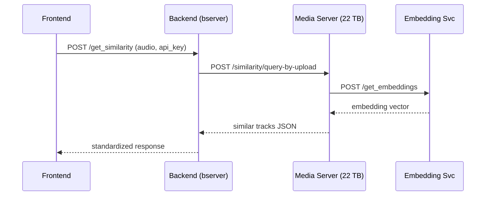
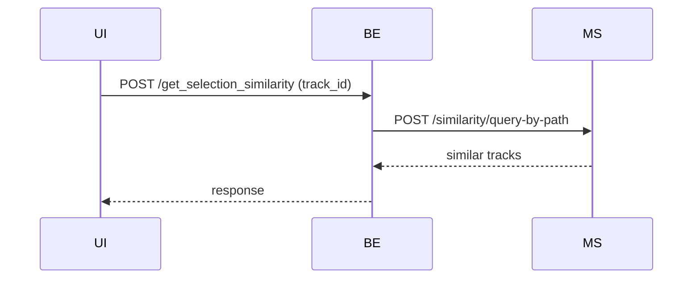
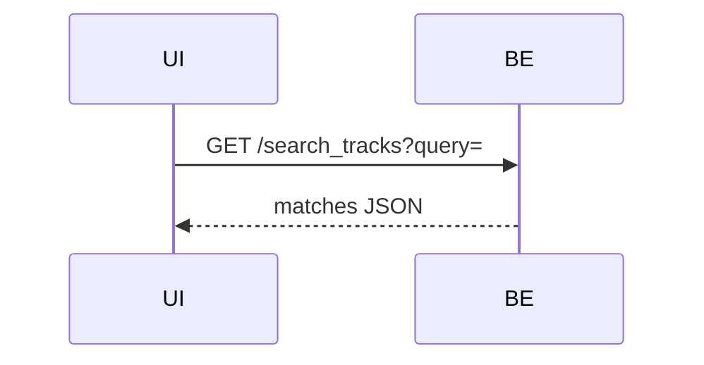
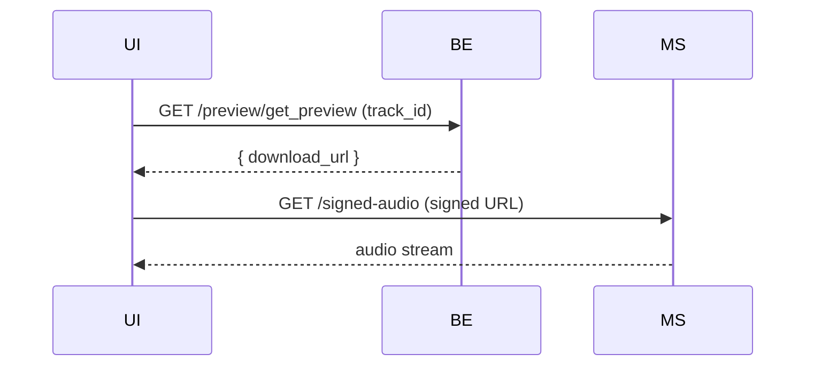
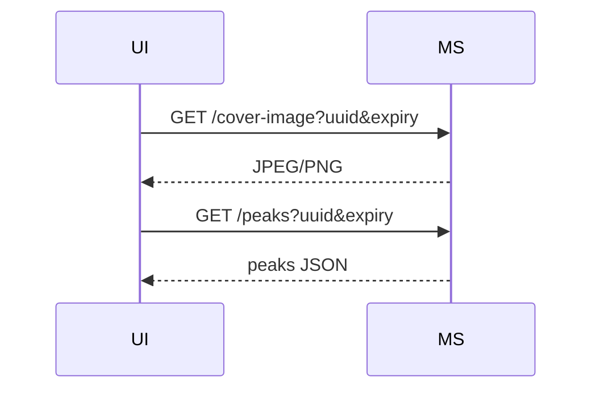
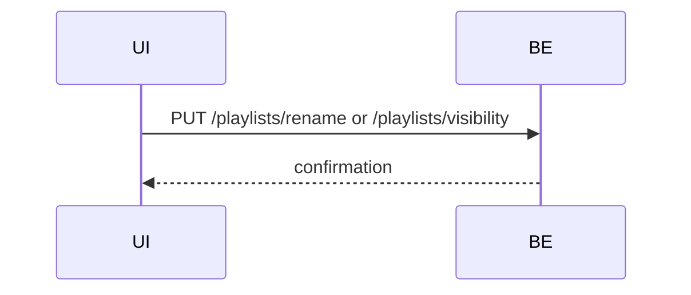
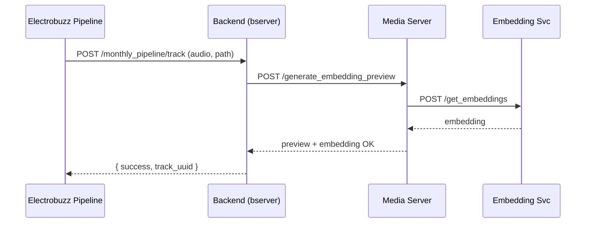

Below is a **concise set of logic flows** (in Markdown) that begin **only** from the two origins—**the Resomix web frontend** and **the Electrobuzz monthly-pipeline server**.
Each flow lists, in order, every server the request touches and the main result it achieves. JavaScript-style Mermaid sequence diagrams are included.

---

## 1  Frontend-Originated Flows

### 1.1  Upload-for-Similarity (“Drag & Drop a track”)

The user uploads an audio file and immediately receives a ranked list of similar tracks.

**Narrative**

1. **Frontend** (`app.resomix.com`) sends `POST /get_similarity/` + audio file → **Backend** (`bserver.resomix.com`, Alwyzon).
2. Backend extracts metadata, stores the temporary track, then calls **Media** (`media.resomix.com`, 22 TB) `POST /similarity/query-by-upload/`.
3. Media server validates file, forwards it to its local **Embedding micro-service** (`/get_embeddings`), performs FAISS search, and returns the ranked list.
4. Backend deduplicates results, wraps them in the standard `{ success: true, data: {...} }` schema, and replies to **Frontend**.
5. Frontend renders the similar-tracks list, and optionally offers a “Generate Preview” button that triggers Flow 1.4 below.

---

### 1.2  Selection-Similarity (“Find more like this search result”)

Identical to 1.1, but the frontend sends a known `track_id`; the Media search is by *path* instead of by *upload*.

---

### 1.3  Track Search

A plain text search never leaves the backend.

Outcome: list of matching tracks with relevance scores.

---

### 1.4  Preview Streaming (listen button)

1. **Frontend** requests `GET /preview/get_preview/?track_id=` → **Backend** produces a **signed URL**.
2. Frontend then performs `GET /signed-audio/?uuid&XPI&hmac` directly against **Media**, which streams the MP3 preview (handles Range headers, HMAC & Fernet checks).

---

### 1.5  Cover-Art & Waveform Peaks

Both calls bypass the backend altogether.

Outcome: image and waveform data for visualisation.

---

### 1.6  Playlist Mutations (rename / visibility)

Stay inside the backend.

---

### 1.7  Feedback / Contact Forms

Single-hop POST to backend → DB (and optional Google Sheets) → confirmation.

---

## 2  Electrobuzz-Originated Flow

### 2.1  Monthly Pipeline Ingestion

The scheduled pipeline imports thousands of new tracks into the Resomix ecosystem.

**Narrative**

1. **Electrobuzz Server** runs `monthly_cron.py`, finds files, then `update_database.py` posts each track to **Backend** `POST /monthly_pipeline/track/` with file + path.
2. Backend extracts metadata, creates UUID, and calls **Media** `POST /generate_embedding_preview` (runs in parallel: embedding + 128 kbps preview).
3. Media triggers its **Embedding micro-service** and local FFmpeg; when both finish it returns status to Backend.
4. Backend writes the new track and preview locations into the master DB and replies `{ success: true, track_uuid, path }`.
5. Electrobuzz marks the track as processed in its `_tracks/*.json` success log.

Outcome: every new track now exists in the database **with embeddings and an MP3 preview**, ready for similarity search and streaming.

---

### 2.2  (Internal) Error-Retry Loop

If Backend returns `502/503`, Electrobuzz re-queues the track and retries on the next run; errors are logged in `{MM-YYYY}_errors.json`.&#x20;

---

## Legend

| Abbreviation | Server (Role)                               | Domain                             |
| ------------ | ------------------------------------------- | ---------------------------------- |
| UI           | Resomix Web Frontend                        | *browser→app*                      |
| BE           | Backend API (Alwyzon)                       | `bserver.resomix.com`              |
| MS           | Media API (22 TB)                           | `media.resomix.com`                |
| EM           | Embedding Micro-service (internal to media) | `media.resomix.com/get_embeddings` |
| EB           | Electrobuzz Monthly Pipeline                | *electrobuzz host*                 |

---

These flows should give your team a single-page overview of **how every end-to-end request traverses the three main servers**—and where the heavy lifting (embeddings, previews, DB writes) actually happens.
