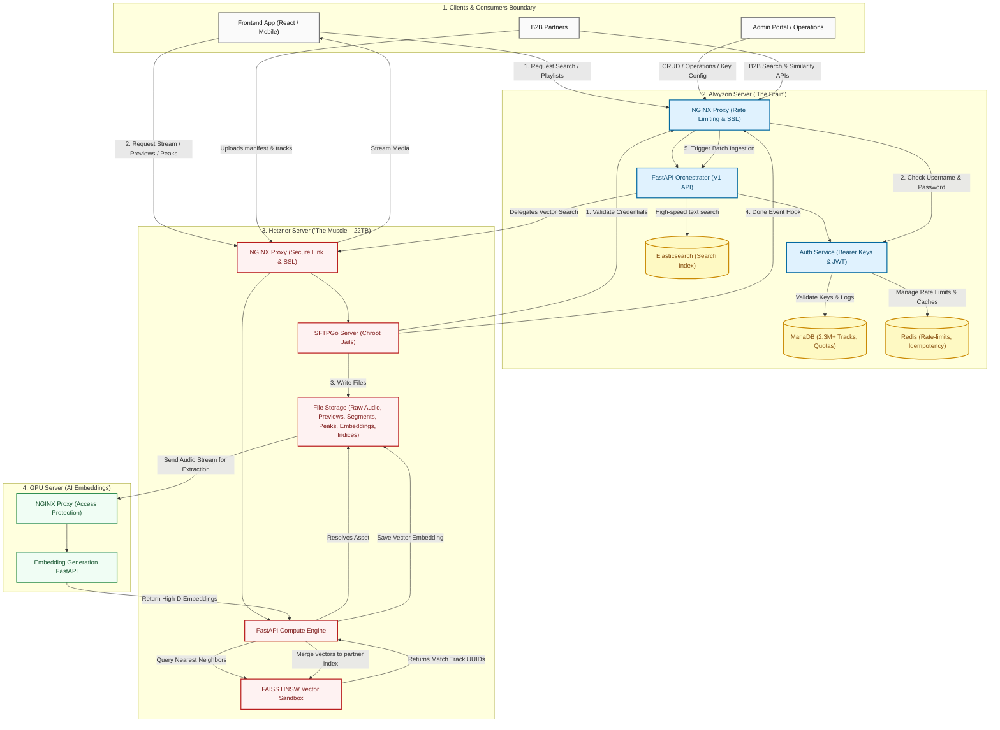
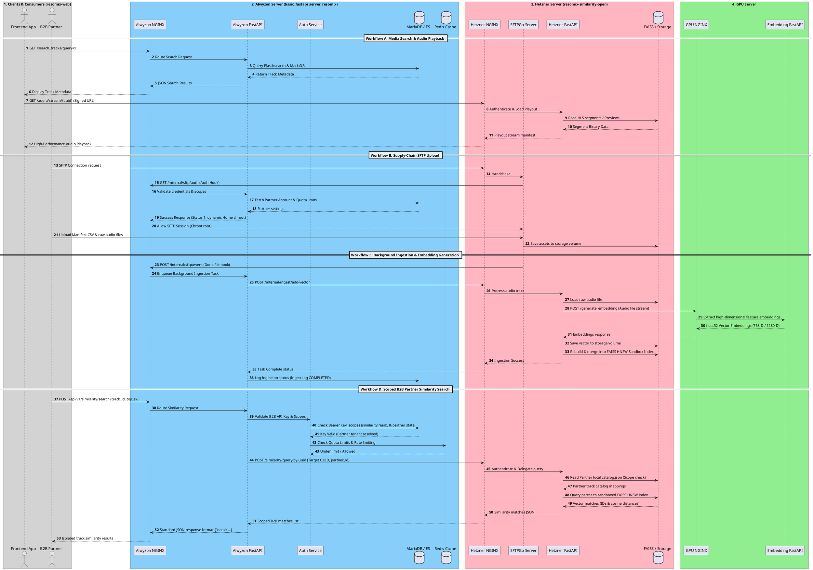

# Resomix Server Architecture & Workflow Diagram

This document provides a comprehensive technical overview and visual workflow diagram of the three primary servers in the Resomix ecosystem: **Alwyzon ("The Brain")**, **Hetzner ("The Muscle")**, and the **GPU Server ("Embedding Generation")**.

---

## 1. Core Server Communications

The three servers coordinate to isolate metadata orchestration, physical file handling, and deep learning feature extraction:

*   **Alwyzon $\leftrightarrow$ Hetzner (Gateway & Processing)**: Alwyzon acts as the secure, transactional controller. It validates client credentials and queries. When a search or ingestion task is triggered, Alwyzon calls Hetzner's internal endpoints via NGINX. Similarly, Hetzner's SFTPGo calls back to Alwyzon's NGINX to validate B2B uploads credentials and notify completed uploads.
*   **Hetzner $\leftrightarrow$ GPU Server (Compute & Feature Extraction)**: During ingestion pipelines, the Hetzner compute engine streams the raw audio file to the GPU server via NGINX. The GPU server processes it and sends high-dimensional float vector embeddings back to Hetzner to be saved and merged into the FAISS indexes.
*   **Alwyzon $\leftrightarrow$ GPU Server (Fully Decoupled)**: No direct communication. The Alwyzon "Brain" is completely decoupled from heavy AI model weights, allowing it to focus entirely on fast database access and user session transactions.

---

## 2. Key Similarity Request Workflows

### Scenario A: Scoped B2B Partner Similarity Search
1.  **Request Ingress**: B2B Partner calls `POST /api/v1/similarity/search` passing their Bearer API Key (`rmx_...`) and a track ID.
2.  **API Gate & Quota Checks**: Alwyzon's NGINX passes the request to FastAPI, which triggers the Auth Service. The system validates the key, permission scopes (`similarity:read`) in MariaDB, and checks Redis to verify they are under their API quota and rate limits.
3.  **Hetzner Delegation**: Alwyzon delegates the similarity search to Hetzner by calling `POST /similarity/query-by-uuid`, sending the target track ID and the partner's unique `partner_id`.
4.  **Sandbox Search**: Hetzner's FastAPI loads/accesses only the partner's local catalog JSON file and queries their *isolated* FAISS sandbox HNSW index in memory. 
5.  **Secure Output**: The nearest neighbors matched *strictly inside their own catalog* are calculated and returned to Alwyzon, which formats the JSON response as `{"data": [...]}` and delivers it back to the B2B Partner.

### Scenario B: Similarity Search from a Frontend End-User
1.  **Request Ingress**: An end-user on `resomix-web` (Frontend App) triggers similarity search (e.g., clicking on a track in a public playlist) calling `GET /api/v1/playlists/similarity/{playlist_id}`.
2.  **User Authentication**: The Alwyzon gateway validates the request using the user's JWT access token in the headers.
3.  **Global Catalog Similarity**: Since frontend users search across the global catalog, Alwyzon calls Hetzner requesting matches from the **Global Open FAISS Index** (which is indexed under the public catalog `partner_id = 0` / default sandbox tenant).
4.  **HLS Playback Stream**: Hetzner's HNSW vector search returns global similar track UUIDs. Alwyzon converts these into a temporary similarity playlist, saves it, and renders an HLS playlist index manifest (`.m3u8`).
5.  **Signed Media Playback**: The Frontend App fetches the `.m3u8` playlist index and requests secure `.ts` stream segments directly from Hetzner's NGINX (using signed, Fernet-encrypted short-lived tokens), providing high-speed, secure audio streaming to the end-user.

---

## 3. System Components & Servers Overview

### A. Alwyzon Server ("The Brain")
*   **Role**: Handles orchestration, metadata cataloging, search indexes, user sessions, partner keys lifecycle, and B2B API gateway queries.
*   **Core Systems**:
    *   **NGINX**: Acts as the primary ingress proxy, enforcing global rate limits (`api_rl`, `global_rl`, `admin_rl`), managing Let's Encrypt SSL, and mitigating automated scans with Fail2Ban.
    *   **FastAPI**: Serves public, admin, and partner-restricted REST routes.
    *   **Auth Service**: Centralized access gate processing B2B Bearer keys (`rmx_<tier>_...`), user JWT tokens, and verifying SFTP credentials.
    *   **MariaDB**: Stores relational data for over 2.3M+ track metadata profiles, partner accounts, subscription levels, and transactional ingestion queues.
    *   **Redis**: Caches API quotas, rate-limiting counters, and partner-isolated idempotency key headers.
    *   **Elasticsearch**: Powering ultra-high-speed text and faceted searches across the metadata catalog.

### B. Hetzner Server ("The Muscle" - 22TB Storage)
*   **Role**: Handles physical supply-chain audio file storage, chunked HLS preview generation, wave visualizer peak extraction, and high-performance multi-tenant vector searches.
*   **Core Systems**:
    *   **NGINX**: Manages asset delivery paths with secure Fernet/HMAC validation.
    *   **SFTPGo**: Exposes secure SFTP chroot home directories for partners to upload raw MP3/WAV files and manifest CSVs.
    *   **FastAPI Compute Engine**: Executes internal APIs to provision directories, rebuild indexes, and trigger audio processing hooks.
    *   **FAISS HNSW Vector Sandbox**: Stores partner vector indexes in memory, hot-swapping isolated index workspaces thread-safely via our reentrant sandbox.
    *   **File Storage (22TB)**: Organizes original raw audio binaries (`RAW/`), generated FAISS indexes, catalog mapping JSON files, visualizer waveform peak coordinates, and HLS segments (`.ts` and `.m3u8` playlists).

### C. GPU Server ("Embedding Generation")
*   **Role**: High-speed deep learning inference cluster.
*   **Core Systems**:
    *   **NGINX**: Directs ingestion calls to the local FastAPI listener, protecting the model execution layer.
    *   **Embedding Generation FastAPI**: Runs GPU-accelerated PyTorch audio analysis pipelines (including MAEST and Discogs models) to instantly convert audio binary wave streams into compact high-dimensional float feature embeddings.

---

## 2. Server Architecture Workflow (Mermaid)

The following Mermaid diagram traces consumer, administrator, and B2B partner interactions, showing the complete flow of data across the three NGINX-shielded servers:

---

## 3. Server Transaction Sequence (PlantUML)

The following PlantUML sequence diagram maps the multi-server network transactions and database hooks executed during media consumption, B2B uploads, and GPU ingestion pipelines:

